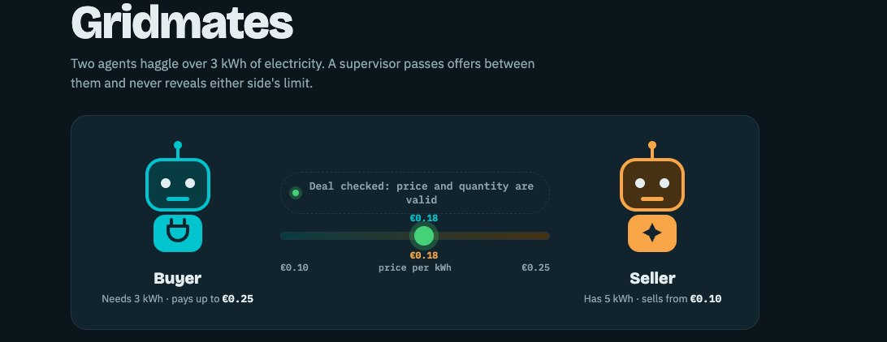

# Negotiation

Gridmates: two AI agents, a buyer and a seller, negotiate the price of 3 kWh of electricity while a supervisor relays their offers. A web page runs the live negotiation and animates it.



- Agent code and setup: [`gridmates/`](gridmates/)
- Run instructions: [`gridmates/README.md`](gridmates/README.md#website)

```bash
cd gridmates
mda dev                                   # agent server on http://127.0.0.1:2024
cd web && python3 -m http.server 8000     # then open http://localhost:8000
```
